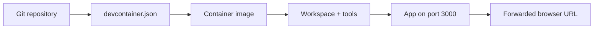
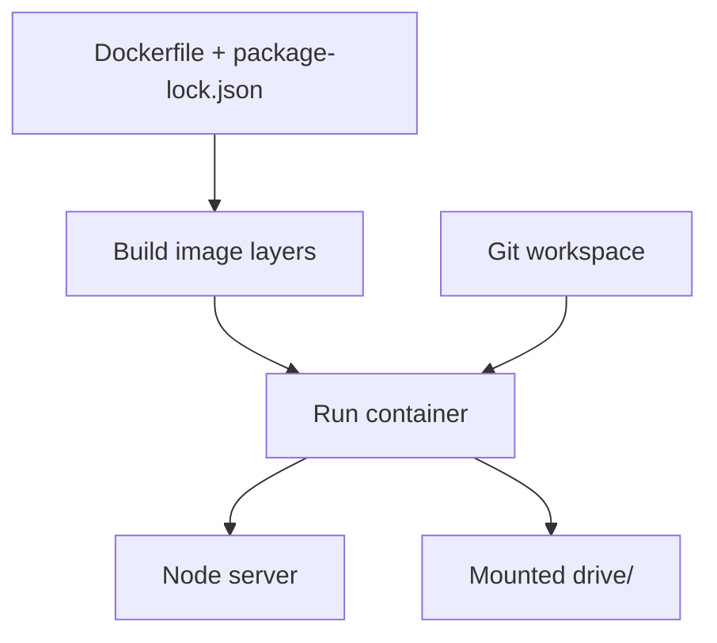
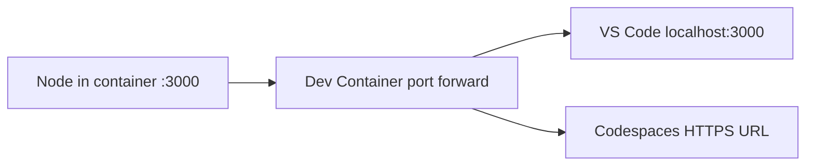
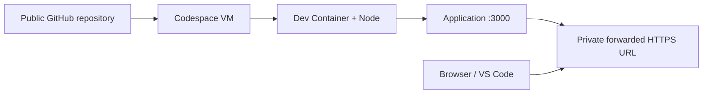

# Develop Anywhere — LiveDeck Markdown slide source

> DOSCloud-inspired visual system sourced from the original **DOSCloud.pptx** Atlanta deck.
> Slide content is public; presenter notes in this Markdown file are omitted from `livedeck.json`, but are still visible in this public repository.
> Each `<!-- slide: ... -->` section is built by `node build-deck.mjs`. A standalone `---` line **inside** a slide means two columns, not a slide break.
<!-- slide: boot | title | 0.5 -->
# DEVELOP ANYWHERE

`C:\> devcontainer /boot`
**DEV CONTAINERS · CODESPACES · REMOTE DEVELOPMENT**
One repository. Multiple machines. One repeatable development environment.
**Live build:** [DOSCloud Mini](https://github.com/theonemule/doscloud-mini)

<!-- presenter-notes
Set the stage with the old DOSCloud look from the Atlanta deck. Explain that DOSCloud Mini is a working Node.js application with a browser-based DOSBox-X emulator. Today the application is the demo vehicle; the development environment is the subject.
-->

<!-- next-slide -->

<!-- slide: problem | statement | 1 -->
# It worked on my machine…

**C:\> ERROR 0xENV**
Different runtimes. Missing tools. Wrong ports. Works only on one developer's laptop.
**A repository should define how to develop the application—not just the application itself.**

<!-- presenter-notes
Contrast committing code with committing a repeatable environment. No need to argue that containers solve every problem; the point is to reduce time lost before a developer can make a useful change.
-->

<!-- next-slide -->

<!-- slide: idea | columns | 1 -->
# What we're actually building

### Application
- Source code + package lock
- Browser DOSBox-X assets
- `drive/` — persistent DOS C:
- WebSocket and HTTP server
---
### Development contract
- `devcontainer.json`
- Base image or Dockerfile
- Lifecycle commands
- Forwarded ports
- Editor/remote integration

<!-- presenter-notes
Make the distinction between app runtime, container image, and development experience. The dev container definition is a contract for editor setup around a container, not an alternative to Git.
-->

<!-- next-slide -->

<!-- slide: journey | agenda | 1 -->
# Today's four live demos

1. **BOOT** — minimal `devcontainer.json` and Hello World
2. **CONFIG** — Node app, lifecycle, ports, custom Dockerfile
3. **CLOUD** — open the same repo in GitHub Codespaces
4. **REMOTE** — SSH, attach to containers, debug remotely

**Expect live terminal time to outweigh slides.**

<!-- presenter-notes
The talk is about an hour. Slides give conceptual handles; the demos prove things. Mention that all demo files are committed in the public DOSCloud Mini repository, so the audience can follow along.
-->

<!-- next-slide -->

<!-- slide: mental-model | diagram | 1.25 -->
# The dev container mental model


**Definition + image + mounted source + startup = usable workspace.**

<!-- presenter-notes
Walk left to right. An image provides OS and tools; VS Code or Codespaces manages the workspace, lifecycle and port forwarding. The app is not inherently a dev container.
-->

<!-- next-slide -->

<!-- slide: demo1-intro | section | 0.25 -->
# DEMO 01 — BOOT

`C:\> TYPE DEVCONTAINER.JSON`
Smallest useful developer environment
**Goal: no Dockerfile, no extra features, one line of output.**

<!-- presenter-notes
Switch from slides to VS Code. Open the repository root and select the Hello World configuration.
-->

<!-- next-slide -->

<!-- slide: hello-code | code | 1 -->
# One JSON file, one runtime

```json
{
  "name": "01 — Hello World",
  "image": "mcr.microsoft.com/devcontainers/javascript-node:1-22-bookworm",
  "remoteUser": "node",
  "postCreateCommand": "node demos/01-basic/hello.js"
}
```
**File:** `.devcontainer/01-hello-world/devcontainer.json`

<!-- presenter-notes
Point out the absolute minimum: image, optional lifecycle action, and an unprivileged user. The image tag chooses Node 22. No app ports because the example is a CLI hello-world program.
-->

<!-- next-slide -->

<!-- slide: demo1-live | steps | 6 -->
# LIVE: Hello World in a container

1. Open **Dev Containers: Reopen in Container**.
2. Select **01 — Hello World**.
3. Show VS Code attaching to the container.
4. Run `node --version` and `node demos/01-basic/hello.js`.
5. Inspect the container terminal; explain where Node came from.

**Checkpoint:** the greeting appears without installing Node on the host.

<!-- presenter-notes
Budget six minutes including time for the first container. If a rebuild is slow, use a prebuilt container and jump directly to the output. Ask the audience: what did we put in Git to make this reproducible? Answer: the definition and sample application.
-->

<!-- next-slide -->

<!-- slide: demo1-takeaway | minimal | 0.5 -->
# The first container did almost nothing

That's the point.

**We described a development environment in six lines and made it repeatable.**

Next: make the environment run a real web application.

<!-- presenter-notes
Keep brief. The initial demo is the baseline for all subsequent additions.
-->

<!-- next-slide -->

<!-- slide: anatomy | cards | 1.25 -->
# `devcontainer.json` is the control panel

### Image/build
Select an image or custom Dockerfile.
---
### Lifecycle
Run `postCreateCommand` and `postStartCommand`.
---
### Access
Forward app ports; optionally add editor customizations.

<!-- presenter-notes
A devcontainer.json is consumed by the Dev Containers tooling (VS Code/Codespaces); do not confuse its `forwardPorts` with Docker's `EXPOSE` or `-p`. Extensions/settings are optional. This talk keeps only the minimum needed by Node.
-->

<!-- next-slide -->

<!-- slide: lifecycle | timeline | 1.5 -->
# The lifecycle matters

- **Build** — produce/reuse an image with Node and dependencies
- **Create** — create workspace container, mount source
- **postCreate** — `npm ci && npm test`
- **postStart** — start server if not running
- **Edit** — rebuild image only when Dockerfile changes

**Don't reinstall every tool on every terminal open.**

<!-- presenter-notes
Explain `postCreateCommand` runs at creation (not on every terminal), while `postStartCommand` is for each start. The app script checks health before starting to avoid duplicate servers. Rebuild versus reopen is important.
-->

<!-- next-slide -->

<!-- slide: options | comparison | 1.25 -->
# Three ways to describe the environment

### Prebuilt image
Start fast. Minimal maintenance.

**`image: ...`**
---
### Custom Dockerfile
Control layers and dependencies.

**`build: { dockerfile: ... }`**

**Compose is an additional choice when multiple services are needed—not required here.**

<!-- presenter-notes
Avoid overengineering: DOSCloud Mini needs Node and npm packages, not Go or a database. Explain when Compose becomes useful for app+database, but the demo remains single service.
-->

<!-- next-slide -->

<!-- slide: demo2-intro | section | 0.25 -->
# DEMO 02 — CONFIG

`C:\> BUILD /CUSTOM`
Move from Hello World to the actual DOSCloud Mini application
**Node.js 22, npm dependencies, tests and port 3000.**

<!-- presenter-notes
Open the real repository root and select example 02, then 03. The difference is image acquisition, not the app source or browser UX.
-->

<!-- next-slide -->

<!-- slide: node-config | code | 1.25 -->
# The Node app configuration

```json
{
  "name": "02 — Node.js app development",
  "image": "mcr.microsoft.com/devcontainers/javascript-node:1-22-bookworm",
  "remoteUser": "node",
  "forwardPorts": [3000],
  "postCreateCommand": "npm ci && npm test",
  "postStartCommand": "bash .devcontainer/start-app.sh"
}
```
**Source:** `.devcontainer/02-node-app/devcontainer.json` (abridged)

<!-- presenter-notes
The source config also labels the forwarded port. Show why npm ci is more repeatable than an unconstrained install. The server listens on 0.0.0.0:3000 inside the container; its public visibility still depends on forwarding.
-->

<!-- next-slide -->

<!-- slide: dockerfile | code | 1.25 -->
# A custom Docker image: precise, not bloated

```dockerfile
FROM mcr.microsoft.com/devcontainers/javascript-node:1-22-bookworm
USER root
COPY package.json package-lock.json /opt/doscloud-mini/
RUN cd /opt/doscloud-mini && npm ci --omit=dev --no-audit --no-fund
ENV NODE_PATH=/opt/doscloud-mini/node_modules PORT=3000 HOST=0.0.0.0
USER node
```
**Source:** `.devcontainer/Dockerfile`

<!-- presenter-notes
Docker image builds have layered cache semantics. We copy manifests before source and install Node packages into an image path so alternate Docker Compose deployments can resolve dependencies. Avoid extra languages because this application is Node-only.
-->

<!-- next-slide -->

<!-- slide: build-vs-runtime | diagram | 1 -->
# Image layers are not workspace state


**Image:** tools and dependencies. **Workspace:** code and persistent DOS files.

<!-- presenter-notes
Emphasize changes to the Dockerfile require rebuild; changes to JS often require only restart/watcher. The workspace mount means changing source does not require baking it into each image. Beware the difference between the workspace and ephemeral container storage.
-->

<!-- next-slide -->

<!-- slide: ports | diagram | 1 -->
# Port forwarding is a developer feature


**Port 3000 carries HTTP, uploads, REMOTEFS WS and IPX WS.**
**Keep Codespaces forwarding PRIVATE.**

<!-- presenter-notes
Clarify Dockerfile EXPOSE is documentation, VS Code forwardPorts makes the app reachable in development, and docker -p publishes in standalone Docker runs. Codespaces forwards via HTTPS and access control. The emulator needs secure-context APIs, so HTTPS or localhost is important.
-->

<!-- next-slide -->

<!-- slide: demo2-live | steps | 10 -->
# LIVE: From config to running DOSCloud

1. Open `.devcontainer/02-node-app/devcontainer.json`.
2. Select **02 — Node.js app** and rebuild/reopen.
3. Show `npm ci`, tests, and `postStartCommand`.
4. Open forwarded **port 3000**; boot DOSBox-X.
5. Switch to **03 — Custom Dockerfile**; inspect build layers.
6. Show `C:\DOOMS`, upload/save a file, and refresh.

**Checkpoint:** same app and same persisted C: drive; different image strategy.

<!-- presenter-notes
Allow 10 minutes with ready-to-open containers. The custom image takes time on first build; prebuild it before talk. Verify the browser's address and ensure port 3000 is private. The public repo includes the v1.9 DOOM shareware files. Don't casually upload arbitrary copyrighted games.
-->

<!-- next-slide -->

<!-- slide: gotchas | checklist | 1.25 -->
# What breaks first?

- [x] `HOST=0.0.0.0` lets the container accept forwarded connections
- [x] Forward **3000** to the editor/browser
- [x] Use **localhost** or **HTTPS** for browser emulator APIs
- [x] Run `npm test` before the audience arrives
- [ ] Avoid public upload endpoints and public debug ports

<!-- presenter-notes
Walk through the common failures: app binds to 127.0.0.1 inside container only, wrong forwarded port, invalid image build path, missing npm deps, wrong directory, and browser secure-context restrictions.
-->

<!-- next-slide -->

<!-- slide: cloud-shape | diagram | 1.25 -->
# What changes in GitHub Codespaces?


**Same devcontainer.json. Different computer.**

<!-- presenter-notes
Codespaces hosts compute/storage remotely; it is not the same local container magically moved. The repo provides definitions; Codespaces creates an independent workspace and forwarded URL. Prebuilds can improve startup if configured, but they are not needed for this demo.
-->

<!-- next-slide -->

<!-- slide: demo3-intro | section | 0.25 -->
# DEMO 03 — CLOUD

`C:\> CONNECT CODESPACES`
Run the same repository in GitHub's hosted development environment
**No second toolchain setup. No local Docker requirement.**

<!-- presenter-notes
Switch to GitHub. The real public repository is https://github.com/theonemule/doscloud-mini .
-->

<!-- next-slide -->

<!-- slide: codespaces-steps | steps | 1 -->
# Create a Codespace from the actual repo

1. Open **Code → Codespaces → Create codespace**.
2. Choose **02 — Node.js app** or the default custom Docker setup.
3. Observe `postCreateCommand` + tests.
4. Open the forwarded **3000** port.
5. Confirm visibility is **Private** and URL uses HTTPS.

<!-- presenter-notes
A Codespace may choose the root .devcontainer config automatically. Use the config picker for explicit example selection. The production-style DOSCloud app intentionally lacks login, so do not make port 3000 public for an audience demo.
-->

<!-- next-slide -->

<!-- slide: demo3-live | steps | 8 -->
# LIVE: Same project, cloud compute

1. Launch an existing/prebuilt Codespace or create a new one.
2. Show VS Code browser editor + terminal.
3. `node --version`, `npm test`, `curl localhost:3000/api/health`.
4. Open DOSCloud Mini on the HTTPS forwarded URL.
5. Compare the **same config** with the local Dev Container.

**Checkpoint:** browser emulator boots without a local Node installation.

<!-- presenter-notes
Use an existing Codespace as a safety fallback; avoid burning audience time on image pulls. Mention compute cost and sleep behavior briefly, but don't overfocus. Show the actual underlying file paths and the private forwarded port. Browser's secure APIs work on Codespaces HTTPS.
-->

<!-- next-slide -->

<!-- slide: state | columns | 1 -->
# Same Git history ≠ same disk

### Shared through Git
- JS source and devcontainer files
- DOOM shareware in `drive/`
- Tests and docs
- Committed changes
---
### Not automatically shared
- Uncommitted DOS saves
- Local environment state
- Temporary IPX guest overlays
- Files outside the workspace

<!-- presenter-notes
This bridges to remote development and explains why files you wrote in one Codespace don't materialize on your laptop until committed/pulled. The host C: drive is a persistent workspace directory per instance; guests write into room overlays that are deleted.
-->

<!-- next-slide -->

<!-- slide: remote-shape | cards | 1.25 -->
# Remote development is not one thing

### Remote-SSH
Editor connects to a Linux host; open source there.
---
### Dev Container on remote
Rebuild/reopen the same workspace on that host's Docker.
---
### Attach to running container
Inspect an existing container and its filesystem/processes.

<!-- presenter-notes
Define each route precisely. Remote-SSH extends the editor to a host, Dev Containers builds the defined environment, Attach-to-Running-Container inspects an existing container. They differ in lifecycle and persistence. Don't suggest attaching automatically gives production parity or safe debugging access.
-->

<!-- next-slide -->

<!-- slide: demo4-intro | section | 0.25 -->
# DEMO 04 — REMOTE

`C:\> SSH /ATTACH`
Develop on a remote host. Inspect a running container.
**Editor here. Compute there. Port forward in between.**

<!-- presenter-notes
Use the trusted home-lab/dev VM as the remote host; no public exposure needed. If SSH is unreachable from conference Wi-Fi, show the same workflow on a preconnected Remote-SSH window.
-->

<!-- next-slide -->

<!-- slide: remote-vs-attach | comparison | 1.25 -->
# Remote-SSH / Reopen / Attach

### Reopen in Container
Repo + `devcontainer.json` define a new/reused dev environment.

Best for repeatable development.
---
### Attach to Running Container
Connect to a container already running under Docker.

Best for investigating a live service.

<!-- presenter-notes
Explain that attachment is not the same as configuring a new dev environment; attached containers may lack an editor server, package manager, or source mount. Use remote host privileges cautiously.
-->

<!-- next-slide -->

<!-- slide: remote-debug | code | 1.25 -->
# Debugging across the boundary

```bash
# On the remote development host, inside the project/container:
npm test
node --inspect=127.0.0.1:9229 src/server.js
```

**Forward `9229` privately if your debugger needs it.**
Use VS Code **Attach to Node Process** (or an attach configuration).
**Never publish an inspector endpoint.**

<!-- presenter-notes
Run only one server instance: stop the development watcher before starting the inspector. 9229 is *optional*, not in the default devcontainer config, intentionally. Attach from the editor session running on the same remote side or forward it privately. Do not confuse Docker attach, VS Code Attach to Running Container, and Node inspector.
-->

<!-- next-slide -->

<!-- slide: demo4-live | steps | 7 -->
# LIVE: Remote host + container + debugger

1. **Remote-SSH** into the Linux dev host.
2. Open the repo; **Reopen in Container**.
3. Check `docker ps` and application health.
4. Open remotely forwarded **3000** in the local browser.
5. Stop the dev watcher; launch Node with the inspector on loopback.
6. Attach VS Code debugger and hit a server-side breakpoint.

**Checkpoint:** local editor controls Node running on another machine.

<!-- presenter-notes
Keep a connected VS Code session and prepared breakpoint available. If live debug fails, show the Node inspector console and health endpoint and explain the network path. This demo is more about where development compute runs than about DOS gaming.
-->

<!-- next-slide -->

<!-- slide: dos-persistence | diagram | 1 -->
# The DOS drive is a great state demo

```mermaid
flowchart TD
  A[Tracked host drive/] --> B[Room snapshot (hardlinks)]
  B --> C[Guest A + file-level COW]
  B --> D[Guest B + file-level COW]
  A --> E[Git commit + push]
  C --> F[Discard at room end]
  D --> F
```
**Host saves persist. Guest clones do not. Git is explicit.**

<!-- presenter-notes
This is a natural bridge to source mounts and volume persistence. On room creation, snapshot hardlinks freeze the host base; guest overlay edits are isolated. Do not conflate Git with automatic synchronization or promise block-level COW.
-->

<!-- next-slide -->

<!-- slide: guardrails | checklist | 1 -->
# A few non-negotiable guardrails

- [x] Commit the environment definition
- [x] Pin the Node major version and use `npm ci`
- [x] Run tests before opening a forwarded browser
- [ ] Do not make unauthenticated uploads public
- [ ] Do not expose Node inspector `9229`
- [ ] Do not commit secrets or arbitrary licensed games

<!-- presenter-notes
Remind audience that Codespaces port visibility is distinct from having a URL. The app is a controlled demonstration. Keeping the public source readable and the data scope intentional is part of a good conference demo.
-->

<!-- next-slide -->

<!-- slide: final | statement | 0.75 -->
# The takeaway

**Define the environment once.**

Run it on your laptop, in Codespaces, or on a remote host.

`C:\> READY`

<!-- presenter-notes
Recap the concept rather than every command. A dev container moves from environment setup tribal knowledge to a versioned contract.
-->

<!-- next-slide -->

<!-- slide: resources | content | 0.5 -->
# GET THE SOURCE

**Repository:** [github.com/theonemule/doscloud-mini](https://github.com/theonemule/doscloud-mini)

**Examples:** `.devcontainer/01-hello-world`, `02-node-app`, `03-custom-docker`

**Read the guide:** `docs/devcontainer-examples.md`

**More:** [blaize.net](https://blaize.net) · [LinkedIn](https://www.linkedin.com/in/techonfire/) · [me@blaize.net](mailto:me@blaize.net)

<!-- presenter-notes
Leave this visible long enough for photos and note-taking. All three Node-only examples are in the same repo; the root default is equivalent to example 03.
-->

<!-- next-slide -->

<!-- slide: qa | section | 1.5 -->
# C:\> QUESTIONS?

`DOSCLOUD MINI  |  NODE 22  |  PORT 3000  |  STATUS: READY`

Let's talk about containers, remote environments, or the live demos.

<!-- presenter-notes
If time is tight, cut before Q&A; if ahead, invite questions about network forwarding, Codespaces privacy, Docker layers, or debugger port safety.
-->

<!-- next-slide -->
